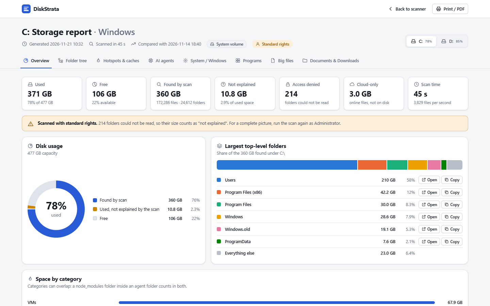

<div align="center">

# DiskStrata

**See exactly where your disk space went.**
A local, read-only disk analyzer with a clean web interface for Windows, Linux and macOS.

[](https://github.com/0xE2E/diskstrata/actions/workflows/ci.yml)


[](LICENSE)



</div>

## Why this exists

DiskStrata started as a personal project: I wanted to know why a 1 TB drive was full, and the usual
tools could tell me *which* folder was big but not *what it was* or *whether it was safe to touch*.
I built something that explains what it finds (package caches, AI-tool histories, virtual disks,
build artefacts, old installers) and I have been using it ever since.

I am now releasing the source so anyone can read exactly what it does. It is a tool that
looks at your whole disk, so you should be able to verify that it stays on your machine.

## What it does

- **Pick the partitions to scan** from a list of every drive or volume on the machine. Scan one or several in one go.
- **Live progress** with a cancel button. No command line needed after the first start.
- **One report per scan**, a single self-contained HTML file with a switcher between the scanned volumes.
- **Explains what it finds**: known caches and temp data, package-manager and IDE caches, browser data,
  virtual machine and container disks, `node_modules` and Python environments, AI coding-agent
  histories (Claude, Codex, Gemini, Cursor, Copilot, Ollama, LM Studio and more), stale OS data, installed programs and your biggest files.
- **Growth tracking**: from the second scan of a volume onwards the report shows what grew since last time.
- **Scan history** in a drop-down, so you can reopen an earlier report without rescanning.
- **Optional elevated scan** (Administrator on Windows, root on Linux and macOS) to include system folders the
  normal account cannot read. It only happens when you click the button and approve the system prompt.

## Safe by design

| | |
|---|---|
| **Read-only** | It lists folders and reads file metadata. It never deletes, moves, renames or modifies anything it scans. The reports give advice as text; you decide what to do. |
| **Local only** | No telemetry, no updates check, no network calls. The server listens on `127.0.0.1` only. |
| **No dependencies** | Pure Python standard library, so there is nothing to audit but this repository. |
| **Hardened local server** | Binds to `127.0.0.1` only. A private launch link sets a session cookie, so other accounts on the machine cannot read your reports. Every action also needs a per-run token, the `Host` header is checked against DNS-rebinding, and pages run only their own scripts (nonce-based Content-Security-Policy). |
| **Your data stays yours** | Reports are saved in a folder on your machine (see below) and are never uploaded. |

## Install and run

You need Python 3.10 or newer.

```bash
# recommended: isolated install
pipx install git+https://github.com/0xE2E/diskstrata
diskstrata
```

or run it straight from a clone:

```bash
git clone https://github.com/0xE2E/diskstrata
cd diskstrata
python -m diskstrata
```

Your browser opens through a private link (printed in the terminal, it ends in `?t=...`). Choose the
partitions, press **Start scan**. If you close the tab, use that link again.
`diskstrata --help` lists the options (`--port`, `--no-open`, `--data-dir`).

### Including system files (elevated scan)

Without elevation some system folders cannot be read, so their size is missing from the totals.
When that matters the app offers to restart itself with higher rights:

| OS | What happens | What it adds |
|---|---|---|
| Windows | UAC prompt | Windows, ProgramData, System Volume Information, other profiles |
| Linux | `pkexec` password dialog (or start it yourself with `sudo python3 -m diskstrata`) | `/var`, `/root`, other users' homes |
| macOS | Standard administrator password dialog | Other users' folders and `/private`. Mail, Messages, Photos and Safari data are protected by macOS privacy rules and additionally need **Full Disk Access** for your terminal or Python (System Settings > Privacy & Security). |

macOS may also ask for permission to read Documents, Desktop, Downloads or removable volumes while it scans.
The scan waits until you answer those prompts.

### Where reports are stored

| OS | Folder |
|---|---|
| Windows | `%LOCALAPPDATA%\DiskStrata` |
| Linux | `$XDG_DATA_HOME/diskstrata` (default `~/.local/share/diskstrata`) |
| macOS | `~/Library/Application Support/DiskStrata` |

Delete the folder to remove all history. `--data-dir` overrides it.

## Accuracy

Sizes are measured the way each OS accounts for them: allocated size on Linux and macOS (like `du`),
logical size on Windows. Hard-linked files are counted once on Linux and macOS. Other mounted
filesystems are never walked into; they are separate volumes you can scan on their own. On a real Ubuntu
24.04 root filesystem the scan total agreed with `df` to within 0.5 %.
Things that can legitimately differ from "used space": snapshots (btrfs, ZFS, APFS, VSS), reserved filesystem
blocks, files deleted but still open, and on Windows the WinSxS component store (hard links, so its
size is overstated). The report explains the unexplained remainder for your OS.

## Platform support

| OS | Status |
|---|---|
| Windows 10/11 | Developed and manually tested here. |
| Linux | Tested on Ubuntu 24.04 (including root and non-root scans). Mounts are read from `/proc/self/mounts`. |
| macOS | Covered by the automated tests on GitHub's macOS runners. The author has not run it on real Apple hardware yet, so reports from real Macs are very welcome. |

## Development

```bash
python -m unittest discover -s tests -t .   # unit and end-to-end tests, no dependencies
pip install ruff && ruff check .
```

The code is organised as: `platforms/` (one adapter per OS), `catalog/` (known locations), `scanner.py`
(parallel read-only walk), `analysis.py` (turns a scan into report data), `jobs.py` (background runs),
`storage.py` (reports and history), `server.py` (local HTTP), `web/` (the two pages).

## License

DiskStrata is **source-available under the [PolyForm Noncommercial License 1.0.0](LICENSE)**.
You may use, study, modify and share it for any noncommercial purpose: personal use, hobby projects, research,
education, and use by charities, schools and public institutions. **Commercial use, or reselling or
repackaging it as part of a commercial product or service, needs my explicit written approval.**
To ask, open an issue on this repository or reach me through my GitHub profile.

Because commercial use is restricted, this is not "open source" by the Open Source Initiative's definition,
which is why I describe it as source-available. The license text is the authority, not this summary.

Copyright (c) 2026 0xE2E. See [NOTICE](NOTICE).

## Contributing

Bug reports, platform reports (especially macOS), and new entries for the known-locations catalog are welcome.
Please run the tests and `ruff` before opening a pull request. Contributions are accepted under the same license.
Security issues: see [SECURITY.md](SECURITY.md).
